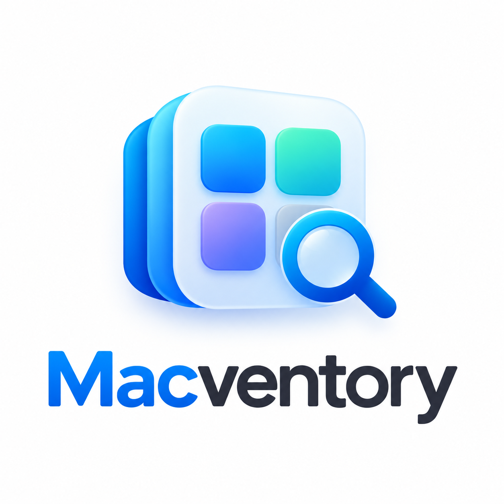
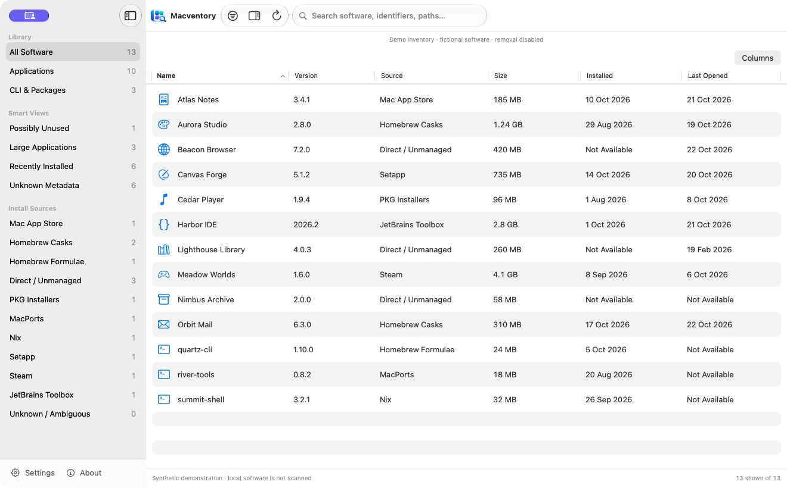
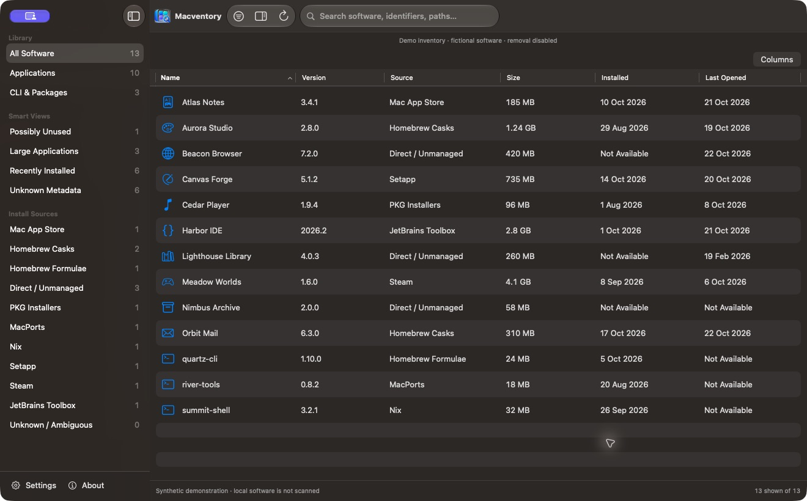
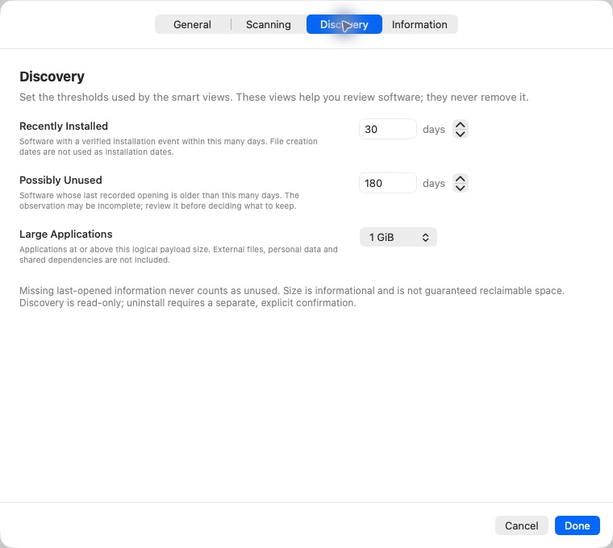
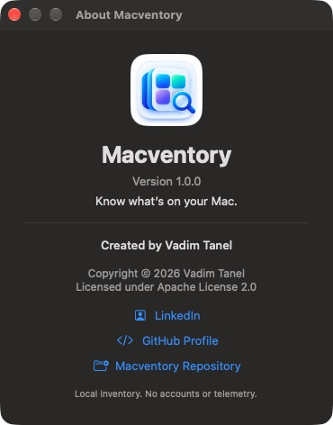
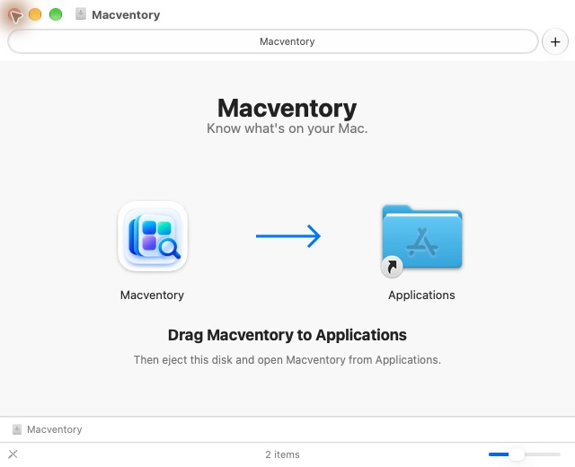

<p align="center"></p>

# Macventory 1.0.0

### Know what's on your Mac.

A free, native macOS application for understanding installed software: where it came from, which version is present, how much space its payload uses, and what is known about installation and usage dates.

[Official repository](https://github.com/vadimtanel/MacVentory) · [Created by Vadim Tanel](https://www.linkedin.com/in/vadim-tanel/) · [](LICENSE)

**Apple Silicon first · macOS 13+ deployment target · Development candidate**



The image is an actual native-app capture using isolated demo data. Every software name and observation shown is fictional; no personal inventory is used in public screenshots.

## Overview

Macventory helps developers, power users and anyone maintaining a Mac answer a simple question: what is installed here? It brings application bundles and supported package-manager records into one searchable inventory, while preserving the difference between verified facts, inferred ownership and unavailable metadata.

Two discoveries of the same physical app can become one row. Separate copies and separate installed package versions remain separate. Unknown dates stay unknown; filesystem creation is never passed off as an installation date.

## Features

- Native source sidebar, inventory table, application icons and evidence-aware details.
- Ten installation-source categories, plus Unknown/Ambiguous.
- Versions, paths, logical payload sizes, installation events and last-opened observations where reliable.
- Search names, identifiers and paths; combine source, kind, confidence, size and date filters.
- Click any of six headers to sort. New fields start ascending; repeated clicks reverse. Missing values stay last, numeric versions compare naturally, and selection remains stable.
- Optional column visibility/customization on macOS 14+, with a fixed-column macOS 13 fallback.
- Recently Installed, Possibly Unused, Large Applications and Unknown Metadata smart views.
- Local snapshot cache, progressive scans, cancellation, sanitized diagnostics and settings drafts.
- Single-application uninstall previews with plan-bound confirmation, fresh ownership checks and conservative source-specific eligibility.
- Application management: verified-process Quit/Force Quit, source-aware Clear App Data, and a dedicated **Leftover Data** view for residual data after removal.

## Screenshots

[Light inventory](Docs/Screenshots/macventory-inventory-light.png) · [Dark inventory](Docs/Screenshots/macventory-inventory-dark.png) · [Settings](Docs/Screenshots/macventory-settings.png) · [About](Docs/Screenshots/macventory-about.png)

[Leftover Data overview with synthetic QA candidates](Docs/Screenshots/macventory-leftover-data.png)

<details><summary>Dark Mode</summary>



</details>

<details><summary>Settings and About</summary>





</details>

## Compatibility

| Item | Target / actual evidence |
|---|---|
| Processor | Apple Silicon M1, M2, M3, M4 and M5 are intended targets; they have not each been independently tested. |
| Actual runtime | Apple M4 Pro on macOS 27.0.1. |
| Minimum deployment | macOS 13.0, configured; minimum-OS runtime is still unverified. |
| Primary binary | arm64. |
| Intel | Optional compatibility is preserved; Intel is not a required release target and current runtime support is not advertised as verified. |
| Tests | Swift Testing requires a macOS 14+ test host. Full Xcode is needed for Xcode-project/XCUITest validation. |

## Installation

Version **1.0.0** is prepared locally; no GitHub Release has been published by this execution. Download binaries only from the [official project's Releases page](https://github.com/vadimtanel/MacVentory/releases) once the owner publishes them.

**DMG:** open `Macventory-1.0.0-arm64.dmg`, drag Macventory onto the Applications shortcut, eject the disk, then launch Macventory from Applications or Spotlight. The disk contains the complete app and a visual installation guide. No command-line installation or administrator helper is required.



**ZIP:** extract `Macventory-1.0.0-arm64.zip`, then copy Macventory.app into Applications. End-user Macs do not need SwiftPM, Xcode or development files.

Compare the download's SHA-256 with the checksum file from the same official release. You can calculate it with macOS `shasum -a 256` if comfortable using Terminal; checksum verification is separate from installation. A checksum detects a mismatch but does not independently establish who published the file.

### First launch and Gatekeeper

This project intentionally uses free tools and local **ad-hoc signing**, without paid Developer ID certificates or Apple notarization. An installable app bundle contains the program/resources; an ad-hoc signature seals local code integrity. Developer ID identifies an enrolled developer, notarization is Apple's separate assessment, and Gatekeeper applies macOS launch policy. These are different checks.

A download may be blocked. Attempt to open it and inspect the warning. If you independently trust the official source and checksum, macOS may offer **System Settings → Privacy & Security → Open Anyway**, followed by its normal confirmation prompt. This is a user decision; Macventory never approves itself, clears quarantine or disables protections. Do not bypass malware/damage warnings or disable Gatekeeper/SIP. Availability can depend on macOS and organizational policy; launch on every Mac is not guaranteed. See [Apple's supported procedure](https://support.apple.com/102445) and [installation details](Docs/INSTALLATION.md).

## Quick start

Command-click inventory sidebar categories to combine them. The table includes software matching any selected category, then applies search and filters; overlapping installations appear once. Selecting All Software resets the selection. Leftover Data remains a separate page.

1. Open Macventory. With Scan on launch enabled, the app refreshes automatically; otherwise choose **Refresh Inventory**.
2. Browse Library, Smart Views or an installation source. Sidebar counts exclude hidden system apps; the footer distinguishes shown and total records.
3. Search by name, identifier or path. Open **Filter Software** to narrow results further.
4. Click a column header to sort, then click it again to reverse the direction. Use **Columns** to choose visible fields where supported.
5. Select a row to inspect its metadata and source evidence. Reveal its location or copy its identifier/path from details.
6. Open Settings from the sidebar footer. **Done** validates and applies a draft; **Cancel** or closing without confirmation discards it.

## Installation sources

| Source | Current verification / scope |
|---|---|
| Direct / Unmanaged | Live bundle enumeration verified; a DMG/ZIP download origin cannot be inferred from the bundle alone. |
| Mac App Store | Local receipt evidence is inferred. Positive cases are fixture tested; purchases/receipt cryptography are not authenticated. |
| Homebrew Casks | Live receipt/artifact mappings and native-app merging verified for recognized formats. |
| Homebrew Formulae | Live installed names, keg versions and receipt timestamps verified; separate kegs remain separate. |
| PKG Installers | Live receipt/payload matching verified. A receipt alone does not prove an application still exists. |
| MacPorts | Documented queries and parser fixtures; no live installation on the development Mac. |
| Nix | Supported current-user modern/legacy profile formats fixture tested; arbitrary profiles/system closures unsupported. |
| Setapp | Recognized provider/framework evidence fixture tested and inferred; no live provider verification. |
| Steam | Local library/manifests fixture tested; experimental adapter, no live provider verification. |
| JetBrains Toolbox | Legacy layout and modern generated-launcher association fixture tested. Modern association is inferred; unknown layouts remain unmanaged. |

See the [supported-source matrix](Docs/SOURCE_SUPPORT.md). Missing, empty, unsupported and failed sources are different outcomes. Categories can overlap; discovery counts are not a sum of unique installed applications.

## Smart views

- **Recently Installed:** a verified installation event within the configured number of days. File creation is a separate fact.
- **Possibly Unused:** a recorded opening older than the threshold, default 180 days. Missing usage never means unused; Spotlight history may be incomplete.
- **Large Applications:** payload size at or above the selected threshold. Logical size excludes external data and does not guarantee reclaimable disk space.
- **Unknown Metadata:** records missing important metadata such as size, install time or last-opened information.

## Uninstall

Double-click a row, press Return, or choose **Uninstall…** to open the application-management dialog, titled with the application name. Select independently eligible **Force Quit**, **Clear App Data**, and **Uninstall** actions, review the exact targets and warnings, then check the review checkbox and confirm. The final button names the selected actions. Opening the dialog never starts an operation. Results use operation-specific status and one **OK** button, which fully dismisses the sheet; completed actions cannot be submitted again.

Only a narrow verified app-only Homebrew cask mapping currently qualifies for managed removal. Scripts, extra removal artifacts, ambiguous ownership, protected components, running apps and stale evidence block execution or receive external guidance. Eligible standalone unmanaged bundles directly in `/Applications` or your `~/Applications` folder can be moved to recoverable Trash using Finder’s native API after separate bundle and fresh manager-ownership checks. Inferred source alone never authorizes this; linked, protected, running, stale, installer/manager-owned and service-bearing bundles are excluded. App Store apps retain external guidance. Trash removes only the bundle, not its external data or a complete vendor installation. PKG receipts do not define a safe inverse installation operation; vendor/manager workflows are explained instead.

There is no bulk uninstall, force, zap, automatic dependency cleanup, elevation or user-data sweep. Canceling a started manager operation cannot guarantee rollback.

After success, a read-only result offers one **OK** button. The production message places the refresh instruction on a separate line; simulation explicitly reports that nothing was removed.

**Real destructive execution remains unverified.** Tests validate plans, confirmation and injected simulation, never actual removal. Demo records cannot be uninstalled. Read [uninstall boundaries](Docs/UNINSTALL.md) before evaluating this development feature.

## Application management and Leftover Data

Cleanup moves each selected folder whole, including its contents; parent folders and unselected locations remain. Leftover Data shows whether personal-folder discovery is enabled and links directly to Scanning Settings. Permission failures identify the failed check or Finder request and provide access guidance. Macventory cannot grant itself macOS privacy access or guarantee that protected container cleanup will be allowed.

Build106 adds individual cleanup results: **No Longer Exists** means the target was already absent and Macventory did not delete it. Confirmed missing targets leave the active list immediately; permission failures, changed targets and unknown Finder outcomes remain distinct. Partial scans also reconcile retained observations, without interpreting access errors as missing files. Unknown Trash outcomes are never automatically retried.

If a friendly name is unavailable, a distinctive folder name may provide a bounded lead through the final identifier component. The UI explains that this association is uncertain; broad names are excluded, ambiguous matches stay protected, and the suggestion never establishes ownership or a product name.

Under **Settings → Scanning**, **Discover related folders in Documents, Downloads and Desktop** is off by default. When enabled, bounded direct-child searches suggest folders using known local application names or exact identifiers. These remain **Possible Related Files — Manual Review Required**, excluded from Select All Verified Data. Each needs individual selection, exact-path review and confirmation. Shared, ambiguous, linked or unsafe locations stay blocked. A folder name is never proof of exclusive ownership. This opt-in capability supersedes the no-personal-location-scanning statement below.

Application identity correction: friendly names are retained separately from installed inventory in a local `application-identities.json` index (schema 1, 4,000 records, 4 MiB, two-year retention). Records contain identifiers, names, optional vendor, parent relationship, source and last observation, without installation paths or usage history. Existing snapshot name evidence is migrated before refresh. Local removal records and exact-ID preference/manifests also supply names. Grouping now requires recorded embedded-bundle parent relationships, superseding the product-name association rule below: equal display names or identifier prefixes never merge products. Unresolved names display distinct identifiers. Naming never upgrades ownership or cleanup eligibility.

The context menu retains Copy Identifier, Reveal in Finder, Copy Path and Uninstall…. **Force Quit** appears only for a safely matched running app. Matching uses canonical bundle URL, bundle identifier, process identifier and launch time; process exit must be observed before later steps proceed. Unsaved changes may be lost. Quit normally from the app to save work first. System components and Macventory’s own process are protected.

**Clear App Data** is independent of uninstall. Macventory checks only bounded, normally accessible Library locations using exact bundle identifiers: containers, exact support/cache/log/WebKit directories, saved state and preferences. Exact identifiers are **Verified App Data**; exact display-name directories are **Possible Related Files** and require individual selection; group containers and shared/protected data cannot be moved automatically. The action uses Finder’s Trash, never permanent recursive deletion. It revalidates path identity, roots, symlink safety and nesting immediately before submission and reports every skipped or failed item.

**Leftover Data** lists only groups with discovered, existing candidates. Minimal removal history is retained separately and does not create empty cleanup entries. A general scan of supported Library sources discovers exact preference/cache/container/support/saved-state identifiers and bounded local manifests, even without a previous inventory record or app bundle. There are no product-specific discovery hints. Installed and reinstalled applications are excluded using inventory and Launch Services. Retrospective associations and stale history remain possible-only; absence of an app is not proof of exclusive ownership.

The default **Group by: Application** view combines only identities with a reliable human-readable association; raw identifier resemblance never joins groups. **Identifier** retains the technical one-identifier view. Search and confidence filters operate in both views. **Select All Verified Data** excludes possible, personal, shared and protected data. Possible-related files may be selected one at a time only after reviewing their exact path and confirmation warning. **Move Selected to Trash** opens a separate path-by-path review with a checkbox. A partial scan names the affected locations and blocks only candidates in those locations; independently verified targets remain subject to the same fresh ownership, identity and installed-app checks. Failed or cancelled scans require a retry. Documents, Downloads, Desktop and external volumes are not swept; individually nominated personal subfolders within the current home can be reviewed. Broad home/Library roots, application bundles and linked paths are rejected.

Combined operations validate targets first, verify Force Quit, move approved data to Trash, then perform eligible uninstall. Failures stop later steps and preserve individual results. A Finder request that times out is reported as unknown and may still finish; the UI remains dismissible and does not retry automatically. Success uses “Operation completed.” with a separate operation-specific explanation; simulation always states that nothing changed.

## Settings

- **General:** visibility, appearance and default sorting.
- **Scanning:** launch behavior, supported external locations, additional application/provider roots and manager executable paths.
- **Discovery:** typed day thresholds/steppers and explicit large-size choices, with plain-language explanations.
- **Information:** scanner status, source availability, sanitized diagnostics and inventory-cache scope.

Every page edits the same draft. Done validates, persists once and requests at most one refresh if scan locations or system-application discovery changed. Appearance, sorting, absent-source visibility and threshold changes do not restart discovery. Cancel, Escape or window close discards pending changes. Appearance stays unchanged until Done. Explicit maintenance/export actions are separate from saving settings. See [Settings guidance](Docs/SETTINGS.md).

## Privacy and security

Inventory processing and cache storage are local. There is no backend, account system or telemetry. Discovery never modifies installed software or asks for administrator privileges. External profile/repository links open only when chosen by the user.

Snapshots are stored in `~/Library/Application Support/Macventory/inventory.json`. Sanitized diagnostics include source status/counts, excluding application names, paths, identifiers and raw errors. Full development snapshots are private and must not be uploaded.

Public captures use `--demo`: no real scans, no real cache/preferences, fictional records with no filesystem targets, disabled removal and isolated column state. See [Security](SECURITY.md) and the [publication review](Docs/PUBLICATION_REVIEW.md).

## Building from source

Use a Swift 6 toolchain and macOS SDK. The current source uses APIs from SDK 26 behind runtime availability checks, so an SDK 26+ development environment is needed even when targeting macOS 13.

```sh
git clone https://github.com/vadimtanel/MacVentory.git
cd MacVentory
bash scripts/build-app.sh release
open build/Macventory.app
```

Application source will only be available remotely after an owner-approved initial application commit/push. Until then, use the reviewed local checkout.

Development commands:

```sh
bash scripts/swift-tool.sh test --disable-xctest
MACVENTORY_LIVE_TESTS=1 bash scripts/swift-tool.sh test --disable-xctest
open -n build/Macventory.app --args --demo
bash scripts/package-release.sh
python3 scripts/review-publication.py
```

The build produces a native app with resources, license/NOTICE and an ad-hoc signature; no development helper is needed at runtime. Packaging prepares ZIP, DMG, source archive and SHA-256 files under artifacts/ without committing or uploading anything.

The inspected Swift 6.4 Command Line Tools setup builds with the installed SDK 26.5 because SDK27 lacks its SwiftUI macro plug-in. Its native SwiftPM fallback is deprecated upstream. Restricted environments may need `MACVENTORY_DISABLE_SWIFTPM_SANDBOX=1`; this changes compiler subprocess sandboxing only, not macOS protections. See [release preparation](Docs/RELEASING.md) for full-Xcode commands and pending gates.

## Troubleshooting

| Symptom | What to check |
|---|---|
| Not Available / Unknown | The source may not provide the value; privacy/indexing can limit Spotlight. Refresh, inspect evidence and avoid assuming a missing date means unused. |
| A source is absent | Check Information, manager installation and configured local paths. Macventory does not install providers. |
| Scan Failed / Unsupported | Inspect source status; other sources can still finish. Share sanitized diagnostics, not a private inventory. |
| Too few rows | Clear search/filters, check category and Show system applications. Counts reflect visibility rules. |
| Settings do not persist | Use Done. Cancel/window close intentionally discard the draft. |
| Removal is unsupported | Follow the displayed manager/vendor guidance. Do not bypass ownership or protection checks. |
| A downloaded app is blocked | This candidate is not notarized. Review the warning and the supported per-app Open Anyway procedure above, if you independently trust the download. |

## Contributing

Use [Issues](https://github.com/vadimtanel/MacVentory/issues) or focused pull requests with synthetic reproductions and actual verification. Keep dependencies minimal and provider formats explicit. Run meaningful tests and a native build; mark unavailable Xcode/UI checks honestly. Never remove real installed software during QA. See [CONTRIBUTING](CONTRIBUTING.md).

## License and credits

Created by **Vadim Tanel**. **Copyright © 2026 Vadim Tanel.**

Licensed under [Apache-2.0](LICENSE); attribution is in [NOTICE](NOTICE). The LICENSE remains the official complete legal text, including its appendix template.

Redistributors must follow Apache 2.0's notice/license/change-marking requirements. We additionally ask forks to credit [the original project](https://github.com/vadimtanel/MacVentory) and [creator](https://www.linkedin.com/in/vadim-tanel/) when practical. That courtesy request adds no license restriction and does not require clickable links in every derivative UI. The app uses native SF Symbols for link affordances rather than copied third-party brand logos.

## Project status

The native app, scanners, combined filtering, six-header sorting, settings transactions, demo isolation and conservative uninstall planning are implemented. Local package tests and actual GUI evidence are recorded in [Verification](Docs/VERIFICATION.md).

Xcode build/XCUITest and hosted CI are not yet verified here. Full VoiceOver navigation has not been performed. Minimum-OS execution, clean-machine Gatekeeper behavior and real destructive uninstall behavior remain pending. Intel is optional, not a release requirement. This is a local review candidate, **not a fully verified public binary release**.
